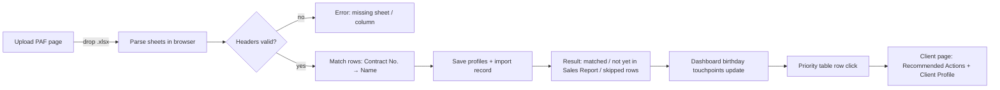

# Design: Purchase Application Form (PAF) Upload and Client Details

| | |
|---|---|
| **Status** | Awaiting approval (Design phase — no production code) |
| **Branch** | `claude/busy-brahmagupta-w68qmn` |
| **Input** | `Fake_Customer_Details_From_PAF.xlsx` (template supplied by the user) |
| **Related** | Dashboard → *Customer Priority & Recommended Actions*; Client detail page |

---

## 1. Executive Summary

Users can open a flagged client from the priority table, but the client page shows only payment and contract data. Personal and buyer details live in the Purchase Application Form (PAF), outside the app.

This design adds:

1. **"Upload PAF" page**: a new sidebar tab, built like *Upload Report*. Drop the PAF workbook (`.xlsx`), see which clients matched, and keep an import history where any file can be removed.
2. **Client Profile on the client page**: Personal, Contact, Buyer & Employment, Spouse and Corporate sections from the PAF.
3. **Recommended Actions on the client page**: every flag for that client (indicator, action, priority), so clicking a row in the dashboard table shows *why* the client is there.
4. **Real birthday touchpoints**: the dashboard's "Relationship Touchpoint" uses the PAF birthdate ("Birthday within N days"), as in the mockup, alongside the purchase anniversary.

### Template findings (drive the design)

| Sheet | Rows | Key columns | Notes |
|---|---|---|---|
| Customer Details | 176 | Customer Number, **Contract Number**, Customer Name (all "Sales Report") | 39 columns: personal, contact, IDs, employment, income, corporate |
| Spouse Details | 82 | Customer Number, Customer Name | No Contract Number, so it is linked through Customer Number |
| Corporate Buyer Template | 0 (headers only) | Customer Number, Customer Name | Optional; parsed when present |

### Key decisions

| Decision | Choice | Why | Rejected |
|---|---|---|---|
| Matching | **Contract Number first, Customer Name as fallback** | Contract Number is exact and already stored per client. The name fallback uses the Sales Report rule (case-insensitive) | Name only (fragile spelling) |
| Profile key | Customer name key (same as `customer_aliases`) | Survives Sales Report removal/rebuild (client ids can change); profiles for customers not yet in the Sales Report attach automatically later | Client id (lost on rebuild) |
| Sensitive IDs | **TIN and Government ID numbers are not imported**; only the ID *type* is kept | Highest-risk fields with no use in this app. Data in browser storage is unencrypted | Store everything |
| Hide-names toggle | Also masks PII on the profile (name, address, phone, email, spouse name) | Same privacy promise the toggle already makes | Toggle affects names only |
| Excel library | **`read-excel-file`** (MIT, small, maintained), lazy-loaded on the Upload PAF page only | npm `xlsx` (SheetJS 0.18.5) has known unpatched vulnerabilities; `exceljs` adds ~1 MB. Lazy loading keeps the main bundle unchanged | SheetJS, exceljs |
| Age | Computed from birthdate, not imported | An imported age goes stale | Store Age column |
| Storage | `localStorage`, like the rest of the app | ~0.6 KB per client → ~0.6 MB for 1,000 clients; fits the ~5 MB budget | New backend |
| Prospect model | PAF data is **not** sent to the Python analysis | Keeps that API free of PII. Income and occupation as model features is a later, separate decision | — |

---

## 2. Information Architecture

```
Sidebar
├── Dashboard
├── Clients
├── Forecast
├── Upload Report
├── Upload PAF            ← NEW  (/upload-paf)
├── Weekly Reports
└── Notifications

Client detail (/clients/:id)
├── Header (name, totals)                        existing
├── Recommended Actions                          ← NEW
├── Client Profile (tabs)                        ← NEW
│   ├── Personal · Contact · Buyer & Employment · Spouse · Corporate
├── Payment Timeline                             existing
├── Contracts                                    existing
├── Documentation Checklist                      existing
└── Milestone History                            existing
```

---

## 3. User Flow



Removing a PAF import replays the remaining PAF imports oldest-first, so a profile falls back to the previous file's values. This is the same model as Sales Report imports.

---

## 4. Wireframes

**Upload PAF page**

```
Upload Purchase Application Forms
Upload the PAF workbook to add client details. Sensitive ID numbers are not imported.

┌ - - - - - - - - - - - - - - - - - - - - - - - - - - - - - - - - - - - ┐
   ⇪  Drag & drop PAF workbooks (.xlsx) here, or click to browse
└ - - - - - - - - - - - - - - - - - - - - - - - - - - - - - - - - - - - ┘

✓ Fake_Customer_Details_From_PAF.xlsx
  176 rows · 168 matched to clients · 8 not yet in the Sales Report · 0 skipped
  82 spouse records linked · 0 corporate records
  [Show unmatched (8) ▾]   Customer 412 · contract 0000-0040-…  (no Sales Report match yet)

Imported PAF files
  File                                     Imported          Rows  Matched
  Fake_Customer_Details_From_PAF.xlsx      24 Nov 2026 11:02  176   168    [🗑]

PAF format
  Sheet "Customer Details" (required) · "Spouse Details" (optional) · "Corporate Buyer Template" (optional)
  Required columns: Contract Number (Sales Report) or Customer Name (Sales Report) …
```

**Client page: new top sections**

```
┌ RECOMMENDED ACTIONS ─────────────────────────────────────────────────┐
│ [Repeat-Purchase Opportunity] Existing repeat buyer (2 properties)   │
│   → Personalized inventory check-in                         HIGH     │
│ [Relationship Touchpoint] Birthday within 3 days                     │
│   → Automated personalized greeting                         MEDIUM   │
└──────────────────────────────────────────────────────────────────────┘
┌ CLIENT PROFILE        source: PAF · Fake_Customer_…xlsx · 24 Nov 2026 ┐
│ [Personal] [Contact] [Buyer & Employment] [Spouse] [Corporate]       │
│  Full name     Navarro, Erika Castillo     Birthdate  19 Jun 1960 (66)│
│  Sex           Female                      Citizenship Filipino       │
│  Civil status  Married                     ID type     Synthetic Test │
└──────────────────────────────────────────────────────────────────────┘
No PAF yet →  "No Purchase Application Form on file. Upload one on the Upload PAF page."
```

---

## 5. UI Layout

- **Upload PAF** reuses the Upload Report layout and components: drop zone, result cards, import history table, format guide. Accepts `.xlsx` only.
- **Recommended Actions card**: one row per flag, using the same `flag-chip` and `priority-pill` styles as the dashboard table. The card is hidden when the client has no flags.
- **Client Profile card**: a tab strip (Personal / Contact / Buyer & Employment / Spouse / Corporate) over a two-column `dl` grid. Empty fields show "—". Tabs without data are disabled, e.g. Corporate for personal buyers.
- **Dashboard priority table**: the whole row becomes clickable (keyboard accessible), not just the name.

---

## 6. UX Decisions

| Decision | Reasoning |
|---|---|
| Separate page from Upload Report | Different file, cadence and owner. Mixing formats in one drop zone causes confusing errors |
| Unmatched rows are kept, not rejected | A PAF is often filed before the first Sales Report includes the buyer. The profile appears automatically once they do |
| Tabs on the profile | 35+ fields would make the client page very long. Tabs group them the way the paper form does |
| Birthday **and** anniversary touchpoints | Birthday is what the mockup asks for; the anniversary still applies to clients without a PAF. One flag per client shows the nearer event |
| Show the PAF source (file and date) on the profile | Users can tell how current the details are |
| Masked values say "Hidden" | Makes clear the data exists but the hide toggle is on |

---

## 7. Component Architecture

```
pages/UploadPaf.tsx                 page (mirrors pages/Upload.tsx)
components/upload/DropZone.tsx      extracted from Upload.tsx, reused by both pages
components/upload/ImportHistory.tsx extracted, generic over the record type
components/client/RecommendedActionsCard.tsx
components/client/ClientProfileCard.tsx   (tabs + field grid)

lib/paf.ts                parsePafWorkbook(rows by sheet) → PafRow[] + errors (pure)
lib/pafImports.ts         applyPafImport / removePafImport / matching (pure)
lib/pafExcel.ts           thin wrapper: File → sheets via read-excel-file (lazy import)
lib/buyerIntelligence.ts  birthday touchpoint added to computeCustomerActions
context/AppDataContext    importPafFile(), removePafImport(), profileFor(client)
```

Extracting `DropZone` and `ImportHistory` avoids duplicating ~120 lines of the existing upload page. They are refactored with no behaviour change.

---

## 8. Design System

No new tokens. The page reuses `glass-card`, `data-table`, `flag-chip-*`, `priority-pill-*` and `Badge`. New classes:

| Class | Purpose |
|---|---|
| `.profile-tabs` / `.profile-tab[aria-selected]` | Tab strip, primary underline for the active tab |
| `.profile-grid` | Two-column `dl` (one column below 640 px) |

---

## 9. Database Schema (`AppData` additions)

```
AppData
  client_profiles: Record<string, ClientProfile>   // key = aliasKey(customer name)
  paf_imports:     PafImportRecord[]               // oldest first

ClientProfile
  customer_number, contract_numbers[], source_import_id, updated_at
  personal:   family_name, first_name, middle_name, sex, birthdate (ISO date), citizenship,
              civil_status, id_type
  contact:    home_address, mailing_address, mobile, home_phone, office_phone, email
  buyer:      buyer_role, buyer_type, authorized_representative
  employment: occupation, employment_type, employment_status, employer, position,
              years_in_work, business_address, gross_monthly_income
  corporate?: legal_form, company_name, nature_of_business, office_address, office_phone,
              website, representative, representative_position
  spouse?:    family_name, first_name, middle_name, sex, birthdate, citizenship, occupation,
              employment_type, employment_status, employer, position, years_in_work,
              gross_monthly_income, mobile, email

PafImportRecord
  id, file_name, imported_at, row_count, matched, unmatched, skipped, rows: PafRow[]
```

**Not stored:** TIN, Government Issued No., spouse TIN/ID numbers, Age (derived), Source Workbook, Data Classification.

**Migration:** `storage.ts` `parseData` defaults `client_profiles: {}` and `paf_imports: []` for existing data. No version bump, same as earlier additions.

**Removal:** rebuild `client_profiles` by replaying the remaining `paf_imports`. A later file's non-empty value wins per field; blanks never erase.

---

## 10. API Design

No server API. Everything is parsed and stored in the browser. Internal contracts (pure functions, unit-tested):

| Function | Input → Output |
|---|---|
| `parsePafWorkbook(sheets)` | `{ "Customer Details": Cell[][], "Spouse Details"?: …, "Corporate Buyer Template"?: … }` → `{ rows: PafRow[], skipped: {row, reason}[] }`. Throws on a missing required sheet or column |
| `applyPafImport(data, {fileName, rows, importedAt})` | → `{ data, record, matched, unmatched }` |
| `removePafImport(data, importId)` | → `data` with profiles rebuilt |
| `profileFor(data, client)` | → `ClientProfile \| undefined` |
| `daysUntilBirthday(birthdate, now)` | → `number \| null` (Feb 29 → Feb 28, as for anniversaries) |

**Header rules:** match by trimmed, case-insensitive column name. Required in Customer Details: `Contract Number (Sales Report)` **or** `Customer Name (Sales Report)`. All other columns are optional, so partial templates still import.

**Value rules:**
- Birthdate `MM/DD/YYYY` text or an Excel date cell. Invalid → field left empty and row noted.
- Income and years: numeric or empty.
- Text trimmed; maximum 300 characters.

**Limits:** file ≤ 10 MB, ≤ 20,000 rows per sheet.

---

## 11. Folder Structure

```
src/
├── pages/UploadPaf.tsx                         NEW
├── components/upload/DropZone.tsx              NEW (extracted)
├── components/upload/ImportHistory.tsx         NEW (extracted)
├── components/client/RecommendedActionsCard.tsx NEW
├── components/client/ClientProfileCard.tsx     NEW
├── lib/paf.ts, lib/paf.test.ts                 NEW
├── lib/pafImports.ts, lib/pafImports.test.ts   NEW
├── lib/pafExcel.ts                             NEW
├── lib/buyerIntelligence.ts (+test)            MODIFIED (birthday touchpoint)
├── lib/storage.ts                              MODIFIED (defaults)
├── types/index.ts                              MODIFIED
├── context/AppDataContext.tsx                  MODIFIED
├── pages/Upload.tsx                            MODIFIED (uses extracted components)
├── pages/ClientDetail.tsx                      MODIFIED (two new cards)
├── pages/Dashboard.tsx                         MODIFIED (clickable rows)
├── components/layout/AppSidebar.tsx            MODIFIED (nav item)
└── App.tsx                                     MODIFIED (route)
package.json                                    MODIFIED (read-excel-file, pinned)
```

---

## 12. Naming Conventions

| Area | Convention | Example |
|---|---|---|
| Domain term | "PAF" in code, "Purchase Application Form" in UI headings | `PafRow`, "Upload PAF" |
| Route | kebab-case | `/upload-paf` |
| Stored fields | `snake_case`, matching `AppData` | `gross_monthly_income` |
| Components | `PascalCase`, grouped by area folder | `components/client/ClientProfileCard.tsx` |
| Flag keys | existing `ActionFlag` union; birthday reuses `relationship_touchpoint` with its own indicator | "Birthday within 3 days" |

---

## 13. Security Considerations

- **PII minimisation:** government ID numbers and TINs are dropped at parse time and never reach storage. A test asserts this.
- **Masking:** the hide-names toggle masks name, addresses, phones, email, employer and spouse name on every screen.
- **Local only:** PAF data never leaves the browser. It is excluded from the prospect-analysis API and from alert emails.
- **Untrusted file:** cell values are rendered as text by React (no HTML injection). Formulas are read as computed values, never evaluated. Size and row caps apply.
- **Dependency:** `read-excel-file` pinned to an exact version. SheetJS from npm is avoided because of its open advisories.
- **Residual risk:** `localStorage` is unencrypted and per-browser. The README will warn against using the app on shared computers; a backend with authentication is the long-term answer (out of scope).

---

## 14. Performance Considerations

| Item | Estimate |
|---|---|
| Parse 176-row template | < 100 ms |
| Parse 20,000 rows | ~1–2 s (shows a "Processing…" state) |
| Storage | ~0.6 KB per profile plus raw rows kept per import for replay (~1 KB per row) |
| Bundle | `read-excel-file` loaded only on /upload-paf (dynamic import), so the main bundle is unchanged |
| Dashboard | Birthday lookup is O(1) per client via the profile map |

---

## 15. Design Risks

| Risk | Severity | Mitigation |
|---|---|---|
| Contract numbers formatted differently between files (e.g. dashes) | Medium | Normalise by stripping spaces and dashes before comparing; name fallback |
| Storage growth from keeping raw rows for replay | Medium | Rows exclude dropped fields; result screen shows storage usage; a storage-full error surfaces as an import error (as today) |
| Several PAF rows for one customer (co-owners, multiple contracts) | Medium | Merge into one profile; contract numbers are collected; per-field last non-empty value wins |
| Sex/age inconsistencies in source data | Low | Shown as imported; age always derived from birthdate |
| Template columns change | Low | Optional columns and case-insensitive headers; only the key column is required |

---

## 16. Build Instructions

1. Add types and storage defaults (§9).
2. `lib/paf.ts`: header mapping, value parsing, dropping ID numbers, spouse/corporate linking by Customer Number. Unit tests use rows mirroring the template.
3. `lib/pafImports.ts`: matching (contract then name), merge, replay on removal, with tests.
4. `lib/pafExcel.ts` with `read-excel-file` (dynamic import), reading all three sheets by name.
5. Extract `DropZone` and `ImportHistory` from `Upload.tsx` with no behaviour change; build `UploadPaf.tsx`; add the route and sidebar item.
6. `RecommendedActionsCard` and `ClientProfileCard` on `ClientDetail.tsx`, with masking via the hide toggle.
7. Birthday touchpoint in `computeCustomerActions` (nearest of birthday and anniversary), with tests.
8. Make dashboard priority rows clickable.
9. Verify with `npm test`, `npm run build` and `npm run lint`; import the supplied template; screenshot the Upload PAF page and a client page; push and check the Vercel preview.

---

## 17. Acceptance Criteria

1. The sidebar shows **Upload PAF**. Dropping the template imports it and reports rows, matched, not-yet-matched and skipped counts, plus linked spouse records.
2. Rows match clients by Contract Number, falling back to Customer Name. Unmatched profiles attach automatically after a later Sales Report adds the customer.
3. The client page shows **Recommended Actions** (all flags) and **Client Profile** tabs filled from the PAF, with the source file and date. Clients without a PAF show an empty-state message.
4. TIN and government ID numbers (customer and spouse) are never stored (verified by test). Only the ID type is kept.
5. With "Customer names hidden" on, names, addresses, phones, emails, employers and spouse names show "Hidden".
6. Removing a PAF import rebuilds profiles from the remaining imports. Blank cells in a later file don't erase earlier values.
7. Clients whose birthday is within 7 days get a "Relationship Touchpoint: Birthday within N days" flag with "Automated personalized greeting".
8. Clicking anywhere on a priority-table row opens the client page.
9. Invalid workbooks (missing sheet or key column) show a clear error and change nothing.
10. Existing behaviour and tests are unchanged. New unit tests pass, and build and lint are clean.
