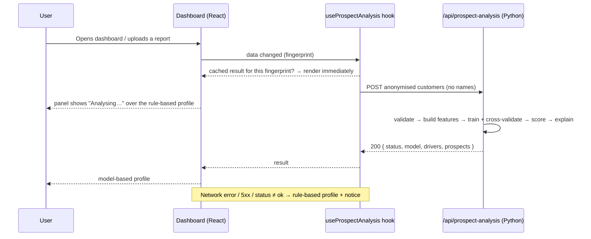

# Design: Python Prospect Analysis for the High-Potential Prospect Profile

| | |
|---|---|
| **Status** | Approved with amendments A1–A3 (24 Nov 2026). Build Stage 1 in progress |
| **Branch** | `claude/busy-brahmagupta-w68qmn` |
| **Scope** | Dashboard → *High-Potential Prospect Profile* panel |
| **Decided by user** | Python runs as a Vercel serverless function; design before build |

---

## 1. Executive Summary

The prospect panel currently uses four hand-picked rules ("meets 3 of 4 criteria"). The thresholds are guesses: nothing checks that they actually predict who becomes a repeat buyer.

This design replaces the guesses with a **statistical model trained on the company's own customers**:

1. **Learn** what single-contract customers who later bought again looked like *at their first purchase* (project, contract value, payment progress, tenure).
2. **Measure** how reliable that pattern is (cross-validated accuracy) and which factors are statistically real (95% confidence intervals).
3. **Score** every current single-contract customer: the likelihood that they become a repeat buyer, compared with the average customer.
4. **Explain** the result in plain language, e.g. *"First-time buyers in Bayview Residences are 2.1× as likely to buy again (95% CI 1.4–3.2×)"*. A statement appears only when the data supports it.

The analysis runs in a stateless Python function (`/api/prospect-analysis`) inside the existing Vercel project. The browser sends **anonymised figures only, never names**. When the API is unavailable or the data is too thin to model, the dashboard falls back to the current rule-based profile and says so.

### Key decisions (with reasoning)

| Decision | Choice | Why | Alternative rejected |
|---|---|---|---|
| Where Python runs | Vercel Python function | User decision. Same project and deploy as `api/send-alert.ts`; no new infrastructure | Pyodide (15–30 MB download), offline notebook (not in-app) |
| Model | L2-regularised **logistic regression** | Gives a calibrated probability, and coefficients translate directly into "×-as-likely" statements a business user can check. Strong baseline for small tabular data (~1,000 rows) | Gradient boosting / random forest: marginally more accurate at best on this size, but opaque and needs SHAP to explain |
| Library | **NumPy only** (Newton/IRLS solver written in ~60 lines) | scikit-learn + SciPy add ~150 MB and risk Vercel's 250 MB function-size limit and slow cold starts. NumPy alone is ~30 MB. Same maximum-likelihood result; standard errors come free from the Hessian | scikit-learn (size), statsmodels (needs SciPy) |
| Label | Repeat buyer = 2+ contracts | Same definition the dashboard already uses | — |
| Features | Taken from each customer's **first contract only** | Prevents leakage: repeat buyers have larger totals *because* they bought twice. Using first-purchase facts compares everyone at the same moment, which is exactly the situation a current prospect is in | Customer-level totals (leaky, inflates accuracy) |
| Accuracy gate | Score prospects only if cross-validated AUC ≥ 0.60 and there are ≥ 30 repeat and ≥ 30 single buyers | Never present a model that is no better than chance as "AI insight" | Always show scores (misleading) |
| Interpretation guard | Plain-language driver shown only if its 95% CI excludes 1.0× | Stops random noise from being presented as a finding | Show all coefficients |

### Approved amendments

| # | Amendment | Reason |
|---|---|---|
| **A1** | `tenure_years` is used in training only as a control. At scoring time every prospect gets the same tenure (the training median), and tenure is never shown as a driver or reason | Otherwise the model ranks long-standing single buyers, who have had years to buy again and didn't, as the best prospects |
| **A2** | Train only on customers whose first purchase is at least 6 months before `as_of`. Newer customers are still scored | A customer who bought last month can't have bought again yet; counting them as "single" mislabels them |
| **A3** | Build in two stages. **Stage 1:** Python engine, tests and a command-line runner for real Sales Reports. **Stage 2:** API endpoint and dashboard, only if Stage 1 reaches CV AUC ≥ 0.60 on real data | Confirms the data predicts repeat buying before investing in UI |

Build note: the contract-value effect is expressed **per doubling** of the first contract value, not per ₱5M, because the feature is log-transformed (a fixed-peso step would not have a constant effect).

---

## 2. Information Architecture

```
Dashboard
└── High-Potential Prospect Profile (panel)
    ├── Model badge ............ method · accuracy (AUC) · trained on N customers · "Python analysis"
    ├── Headline ............... "X high-potential prospects (Y promising)"
    ├── What predicts a repeat buyer (bullets) ... significant drivers, plain language
    ├── Top prospects (expandable list, 10) ...... customer · likelihood · lift · top 2 reasons
    └── Footnote ............... base rate, as-of date, fallback notice when applicable
```

No new route or page. The panel keeps its current position and size in the grid; the prospect list expands inline, like "View all" on the priority table.

---

## 3. User Flow



Re-analysis happens only when the data fingerprint changes: an import, an import removal, or a documents edit. Toggling "hide names" never triggers a call, because names are never sent.

---

## 4. Wireframes

**Model available (status `ok`)**

```
┌ HIGH-POTENTIAL PROSPECT PROFILE ─────────────────────────────────────┐
│ Profile of high-potential prospects likely to convert or become      │
│ high-value buyers.                                                   │
│ [◆ Python analysis · Logistic regression · AUC 0.74 · 940 customers] │
│                                                                      │
│  42 high-potential prospects · 87 promising                          │
│                                                                      │
│  What predicts a repeat buyer                                        │
│  ● First purchase in Bayview Residences — 2.1× as likely (1.4–3.2×)  │
│  ● Every ₱5M more on the first contract — 1.6× as likely (1.2–2.0×)  │
│  ● Reached 10% payment on first contract — 1.8× as likely (1.3–2.6×) │
│  ● Customer for 2+ years — 1.4× as likely (1.1–1.9×)                 │
│                                                                      │
│  [ View top prospects (10) ▾ ]                                       │
│   Customer 57   38%  3.2×  Bayview Residences · ₱12M first contract  │
│   Customer 12   35%  2.9×  10% reached · Aspire Tower                │
│   …                                                                  │
│                                                                      │
│  Base rate 16.7% repeat buyers · analysed 24 Nov 2026 10:12          │
└──────────────────────────────────────────────────────────────────────┘
```

**Fallback (API down, or `insufficient_data` / `weak_signal`)**

```
┌ HIGH-POTENTIAL PROSPECT PROFILE ─────────────────────────────────────┐
│ [! Rule-based profile] Python analysis unavailable: <reason>         │
│  ● (current 4 rule-based bullets with counts — unchanged)            │
└──────────────────────────────────────────────────────────────────────┘
```

Reason texts:
- `insufficient_data`: "Needs at least 30 repeat and 30 single-contract customers (have 12 / 48)."
- `weak_signal`: "Purchase data doesn't yet predict repeat buying reliably (AUC 0.55)."
- Network / 5xx: "Analysis service unreachable. Showing rule-based profile."

---

## 5. UI Layout

- Same `Card.intel-panel` shell; the panel stays `flex-1` so both intelligence panels keep equal height.
- Model badge: small pill under the intro line (`border-primary/30 bg-primary/10 text-xs`). Fallback badge uses the `warning` palette.
- Headline counts: `text-2xl font-mono` for the two numbers.
- Driver bullets: the green bullet style already used. Odds ratio in `font-mono`, CI in `text-muted-foreground`. Drivers that *decrease* likelihood use a muted bullet and are listed after positive ones (max 5 total).
- Top prospects list: compact 4-column grid (name · likelihood % · lift · reasons). Names go through `displayName()` so the hide-names toggle is respected. Each name links to `/clients/:id`.
- While a request is in flight and no cached result exists, a skeleton replaces the bullets. A cached result stays visible with a subtle "Updating…" label.

---

## 6. UX Decisions

| Decision | Reasoning |
|---|---|
| Show likelihood **and** lift ("38%, 3.2×") | A raw 38% sounds low to non-analysts. Lift against the 16.7% base rate shows it's twice-to-triple the norm |
| Show confidence intervals on drivers | "Accurate interpretation" means showing how sure we are. Ranges are short and familiar |
| Hide non-significant drivers | Prevents over-reading noise. The footnote says "only statistically supported factors are shown" |
| Explicit fallback badge | Users must always know whether they're looking at the model or the old rules |
| Max 10 prospects in panel | Keeps the panel scannable; the priority table remains the action list |
| Two tiers only (High-potential / Promising) | Simple, actionable; avoids false precision |

---

## 7. Component Architecture

```
Dashboard
└── ProspectProfileCard            (presentational; chooses model vs fallback view)
    ├── ModelBadge
    ├── ProspectDriverList
    ├── TopProspectList
    └── RuleBasedProspectView      (existing bullets, extracted unchanged)

useProspectAnalysis(data)          (hook: fingerprint, cache, fetch, abort, status)
└── lib/prospectAnalysis.ts        (pure: build request, fingerprint, response types, validation)
```

The hook owns all I/O. `lib/prospectAnalysis.ts` stays pure and unit-testable. The existing `buildProspectProfile` stays as the fallback; nothing is deleted.

Hook state machine:

```
idle → loading → ok
            ↘ fallback(reason)     (network error, non-200, status ≠ ok, invalid response)
```

- In-flight requests are aborted (`AbortController`) when the fingerprint changes or the component unmounts.
- Cache: in memory (module-level `Map<fingerprint, result>`, last 3 entries) plus `sessionStorage` (try/catch, best effort), so navigating between pages doesn't refetch.

---

## 8. Design System

No new tokens. New component classes go in `index.css`, following existing naming:

| Class | Purpose |
|---|---|
| `.model-badge` / `.model-badge-fallback` | Primary-tinted / warning-tinted pill |
| `.driver-bullet-positive` / `.driver-bullet-negative` | `bg-success` / `bg-muted-foreground` dot |
| `.prospect-row` | Compact grid row inside the panel |

---

## 9. Database Schema

**No schema change.** The analysis is derived data. It is not written to `AppData` or `localStorage`, which avoids migrations and stale model output persisting across imports. The only browser persistence is the `sessionStorage` cache described in §7.

Model features (computed server-side, per customer):

| Feature | Source | Transform | Why |
|---|---|---|---|
| `first_tcp` | first contract `contract_value` | `log` then standardise | Contract values are right-skewed; the log gives a per-percentage effect |
| `first_payment_pct` | first contract `payment_percentage` | clip 0–100, standardise | Payment capacity |
| `reached_10` | first contract `payment_percentage ≥ 10` | binary | Mirrors the business milestone; easy to interpret |
| `tenure_years` | `as_of − first credit_date` | years, standardise | **Control variable**: older customers have had more time to buy again. Fixed to the training median at scoring time and never shown (A1) |
| `project_*` | first contract `project_code` | one-hot; projects with < 15 first contracts grouped as `OTHER`; most common project is the reference | Project preference |

"First contract" = earliest `credit_date`; ties are broken by `contract_number`.

---

## 10. API Design

### `POST /api/prospect-analysis`

**Request** (the browser builds it from `AppData.clients`; **no names, no documents**):

```json
{
  "as_of": "2026-11-24T00:00:00.000Z",
  "customers": [
    {
      "ref": "3f6c…uuid",
      "contracts": [
        { "contract_number": "C00012", "project_code": "TWR", "project_name": "Aspire Tower",
          "credit_date": "2024-03-01T00:00:00.000Z", "contract_value": 8000000, "payment_percentage": 12.5 }
      ]
    }
  ]
}
```

`ref` is the client's existing random UUID: it contains nothing personal and lets the browser map results back to customers.

**Validation** (reject with `400 { "error": "..." }`):
- `customers` is an array of 1–20,000 items; each has 1–50 contracts.
- `contract_value` is > 0 and < 10¹¹; `payment_percentage` is 0–100 (values up to 150 are clipped, above that rejected); `credit_date` is ISO and not after `as_of`.
- Body ≤ 4 MB (Vercel's limit is 4.5 MB).

**Response `200`:**

```json
{
  "status": "ok",
  "model": {
    "version": "prospect-logit-1",
    "method": "L2 logistic regression (NumPy IRLS)",
    "trained_on": { "repeat": 157, "single": 783 },
    "base_rate": 0.167,
    "cv_auc": 0.74,
    "cv_folds": 5,
    "analysed_at": "2026-11-24T10:12:03Z"
  },
  "drivers": [
    { "feature": "project_RES", "label": "First purchase in Bayview Residences",
      "odds_ratio": 2.1, "ci_low": 1.4, "ci_high": 3.2, "direction": "up",
      "statement": "First purchase in Bayview Residences — 2.1× as likely to buy again (95% CI 1.4–3.2×)" }
  ],
  "prospects": [
    { "ref": "3f6c…", "probability": 0.38, "lift": 3.2, "tier": "high",
      "reasons": ["Bayview Residences", "₱12M first contract"] }
  ],
  "summary": { "scored": 783, "high": 42, "promising": 87 }
}
```

`status` values:
- `ok`: full result.
- `insufficient_data`: fewer than 30 repeat or 30 single customers. `model.trained_on` is filled in; `drivers` and `prospects` are empty.
- `weak_signal`: CV AUC < 0.60. Same empty arrays plus `cv_auc`.

Errors: `400` validation, `405` non-POST, `500` unexpected (generic message; details only in server logs, without payload data).

### Analysis method (precise)

1. **Features**: per §9. Standardise continuous features using training mean and standard deviation.
2. **Fit**: logistic regression, L2 penalty λ = 1.0 on standardised coefficients (intercept unpenalised), solved by Newton–Raphson/IRLS (tolerance 1e-8, max 50 iterations). The penalty keeps estimates stable when a project perfectly predicts the label.
3. **Validate**: stratified 5-fold CV with a fixed seed (42), refitting the scaler inside each fold. Report mean ROC-AUC (rank-based Mann–Whitney formula).
4. **Gate**: §1 thresholds → `ok` / `insufficient_data` / `weak_signal`.
5. **Interpret**: final fit on all customers. Odds ratio = `exp(β)`, with 95% Wald CI from the inverse penalised Hessian. Continuous effects are re-expressed in business units (per doubling of first contract value, per 10 percentage points of payment). Tenure is excluded from drivers (A1). Keep drivers whose CI excludes 1; sort by |log OR|; at most 5. `tenure_years` is labelled as a control when shown.
6. **Score**: single-contract customers only. `lift = p / base_rate`. Tier `high` if lift ≥ 2.0, `promising` if 1.25 ≤ lift < 2.0, otherwise not returned. Return the top 200 by probability (the panel shows 10).
7. **Reasons**: per customer, the two features with the largest positive contribution `β_j · x_j` (standardised), rendered as short labels.

Self-check on synthetic data: an injected effect (e.g. OR 3.0 for one project) must be recovered within its CI; a label shuffled at random must produce AUC ≈ 0.5 and `weak_signal`.

---

## 11. Folder Structure

```
api/
├── send-alert.ts                 (existing)
├── prospect-analysis.py          NEW  Vercel entry: HTTP handler only (parse → validate → engine → JSON)
└── _prospects/                   NEW  underscore = not exposed as a route by Vercel
    ├── __init__.py
    ├── schema.py                 request validation + response building
    ├── features.py               first-contract extraction, encoding, standardisation
    ├── model.py                  IRLS fit, Hessian/CI, stratified CV, AUC
    └── interpret.py              odds ratios → business units → statements, reasons, tiers
tests/python/                     NEW  pytest: features, model recovery, gating, schema, handler
requirements.txt                  NEW  numpy (pinned) — runtime deps for Vercel
requirements-dev.txt              NEW  pytest (pinned)
src/
├── lib/prospectAnalysis.ts       NEW  request builder, fingerprint, response types/guards
├── lib/prospectAnalysis.test.ts  NEW
├── hooks/useProspectAnalysis.ts  NEW
└── pages/Dashboard.tsx           MODIFIED  ProspectProfileCard uses the hook; rule view extracted
vite.config.ts                    MODIFIED  dev proxy /api → local Python dev server (see §16)
scripts/dev_api.py                NEW  tiny local server wrapping the same handler for `npm run dev:api`
README.md                         MODIFIED  Python setup, local dev, how the analysis works
```

---

## 12. Naming Conventions

| Area | Convention | Example |
|---|---|---|
| Python modules / functions | `snake_case` | `fit_logistic`, `first_contract_features` |
| Python constants | `UPPER_SNAKE` | `MIN_CLASS_SIZE = 30`, `MIN_CV_AUC = 0.60` |
| API JSON fields | `snake_case` (matches existing `AppData`) | `cv_auc`, `odds_ratio` |
| TS types | `PascalCase` prefixed by domain | `ProspectAnalysisResponse`, `ProspectDriver` |
| Feature keys | `<group>_<code>` | `project_RES`, `first_tcp` |
| Model version | `prospect-logit-<n>` | bump when features or method change |

---

## 13. Security Considerations

- **Data minimisation**: only UUID, project, dates, amounts and percentages leave the browser. No names, no documents, no alert email. The hide-names setting is irrelevant to the API.
- **Stateless**: the function stores nothing and does not log request bodies. Logs carry only counts, timing and status.
- **Input validation and size caps** (§10) bound CPU and memory; IRLS iterations are capped.
- **Same-origin only**: no CORS headers are added, so other sites can't call it from a browser.
- **No authentication**: the app has none today. The endpoint holds no data, so the exposure is compute abuse only, which is mitigated by caps and Vercel's platform limits. Revisit when auth is added (see Risks).
- No secrets are required.

---

## 14. Performance Considerations

| Item | Estimate |
|---|---|
| Payload (940 customers) | ~150 KB JSON |
| Fit + 5-fold CV (≈1k × ~12 features) | < 100 ms |
| Cold start (Python + NumPy) | ~1–2 s, first call only |
| Function bundle | ~35 MB (well under 250 MB) |
| Browser | One request per data change, cached by fingerprint; the dashboard never blocks (fallback shown while loading) |

Fingerprint = a cheap hash of the sorted `(ref, contract_number, contract_value, payment_percentage, credit_date)` tuples, computed in a `useMemo`.

---

## 15. Design Risks

| Risk | Severity | Mitigation |
|---|---|---|
| **Survivorship / timing bias**: recent single buyers haven't had time to buy again | High | `tenure_years` control; communicate as "likelihood vs similar-tenure customers" |
| Small data, e.g. few projects with < 15 buyers | Medium | `OTHER` grouping, L2 penalty, CI-gated statements, `insufficient_data` status |
| Users read correlation as causation | Medium | Wording "are X× as likely", never "cause". Footnote |
| Sales Report lacks richer signals (age, income, property type, touchpoints) | Medium | Design is extensible: new columns become features with a model version bump |
| `vite dev` doesn't serve `/api` | Low | Dev proxy + `scripts/dev_api.py`, or `vercel dev` |
| Vercel Python runtime version changes | Low | Pin Python version via `.python-version`/project setting; pin NumPy |
| Unauthenticated endpoint | Low (today) | Stateless, capped. Add auth with the app's future auth |

---

## 16. Build Instructions

1. **Python engine** (`api/_prospects/*`) per §10 "Analysis method", with pytest coverage:
   - feature extraction (first-contract choice, tie-break, `OTHER` grouping)
   - IRLS recovers known coefficients on synthetic data (within CI)
   - shuffled labels → `weak_signal`
   - gating thresholds → `insufficient_data`
   - validation rejects each invalid field
   - determinism (same input → identical output)
2. **Handler** `api/prospect-analysis.py`: `BaseHTTPRequestHandler` subclass named `handler` (Vercel Python convention). POST only; JSON in/out; error mapping per §10.
3. **Dependencies**: `requirements.txt` with pinned `numpy`; `requirements-dev.txt` with pinned `pytest`. Pin the Python version.
4. **Local dev**: `scripts/dev_api.py` serves the same handler on `:5174`; `vite.config.ts` proxies `/api/prospect-analysis` to it; add `npm run dev:api`. `/api/send-alert` keeps its current behaviour.
5. **Frontend**: `lib/prospectAnalysis.ts` (+ tests for request building, names excluded, fingerprint stability, response guard), `hooks/useProspectAnalysis.ts`, then refactor `ProspectProfileCard` into the components in §7. Keep `buildProspectProfile` as the fallback.
6. **Docs**: README section "Prospect analysis (Python)".
7. **Verify**: `npm test`, `npm run build`, `npm run lint`, `pytest`; manual run against the sample report; screenshot of both states.
8. Deploy via the branch preview; confirm the function works on Vercel before any merge to `main`.

---

## 17. Acceptance Criteria

1. With ≥ 30 repeat and ≥ 30 single customers and CV AUC ≥ 0.60, the panel shows the model badge (method, AUC, N), high/promising counts, 1–5 significant drivers with odds ratios and 95% CIs, and an expandable top-10 prospect list.
2. Every driver shown has a CI that excludes 1.0×. Wording never states causation.
3. Prospect likelihoods are probabilities in 0–1; lift = probability / base rate; tiers follow the thresholds in §10.
4. Features are built from each customer's first contract only (verified by test).
5. The request body contains no customer names (verified by test). Names in the list follow the hide-names toggle.
6. API down, `insufficient_data` or `weak_signal` → the rule-based profile renders with a badge stating the reason. The dashboard never errors or blanks.
7. Same data → same result (deterministic). Changing data triggers exactly one new request; toggling hide-names triggers none.
8. Invalid requests return 400 with a clear message; non-POST returns 405.
9. Synthetic tests: an injected OR of 3.0 is recovered within its CI; shuffled labels yield `weak_signal`.
10. All existing tests, lint and build still pass; new TS and Python tests pass.
11. Works on the Vercel preview deployment of the branch.
